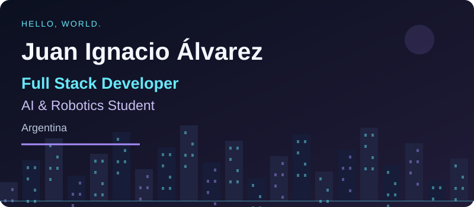
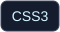
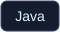
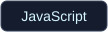
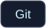
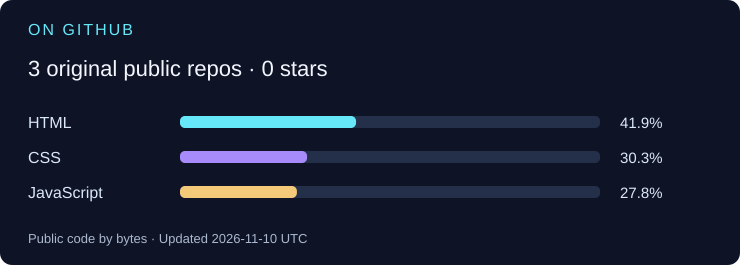

  

**Web development · Intelligent systems · Continuous learning**

[Projects](#featured-projects) · [Tech stack](#tech-stack) · [Activity](#github-activity) · [Connect](#lets-connect)

## About me

Hi! I'm **Juan Ignacio**, a developer from **Argentina** studying for a bachelor's degree in **Artificial Intelligence and Robotics**. I build web applications and enjoy learning how thoughtful interfaces, APIs, and data work together.

My interests span **software development, AI, automation, and robotics**, including Arduino and electronics. I'm strengthening my skills through personal and academic projects, and I'm open to **junior frontend, full stack, and AI-related opportunities**.

**Languages:** Spanish · English (intermediate)

## Tech stack

Technologies and tools I know and continue to practice.

**Frontend**

     

**Backend**

    

**Programming Languages**

  

**Databases &amp; Cloud**

 

**Tools &amp; Development**

     

## Featured projects

### 01 / CryptoDash

A responsive dashboard for **Bitcoin, Ethereum, and BNB**. It brings together market prices, historical SVG charts, USD/EUR selection, and a currency converter. CoinGecko integration includes cached data and explicit loading, stale-data, and error states.

**Built with:** HTML · CSS · JavaScript · CoinGecko API

[View code ↗](https://github.com/Juani-Alvares/proyect-Dashboard) · [Live demo ↗](https://juani-alvares.github.io/proyect-Dashboard/)

### 02 / Scientific Calculator

A browser-based scientific calculator with **trigonometry, logarithms, powers, and factorials**. Includes degree/radian modes, memory controls, keyboard shortcuts, and a dark theme.

**Built with:** HTML · CSS · JavaScript

[View code ↗](https://github.com/Juani-Alvares/Proyect-Calculator) · [Live demo ↗](https://juani-alvares.github.io/Proyect-Calculator/)

## GitHub activity

Contribution playground — animated Snake

Generated daily from GitHub data. Language shares reflect bytes in public, original repositories, not proficiency. If an update fails, the last successful images remain available.

[Explore my contribution history ↗](https://github.com/Juani-Alvares?tab=overview)

## Let's connect

Interested in building something together or discussing a junior opportunity? Find me on **[GitHub](https://github.com/Juani-Alvares)**.

<!-- Add LinkedIn or professional contact details only after the owner supplies and approves them. -->

